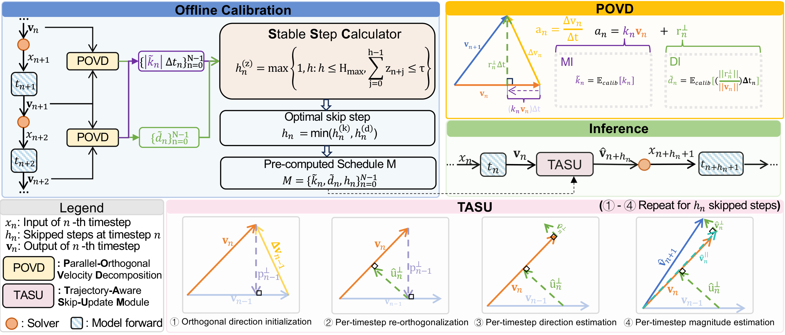
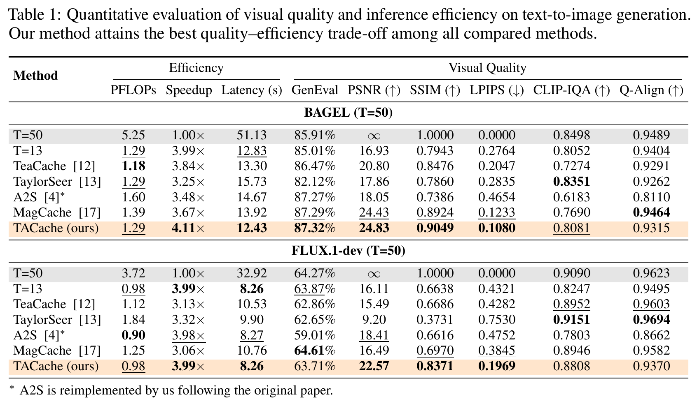
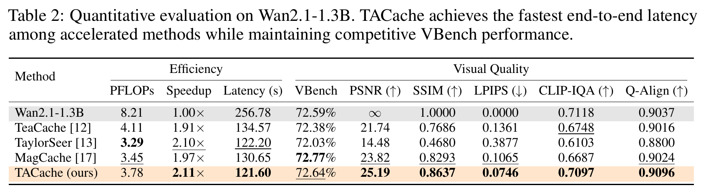

# 🏆 [NeurIPS 2026] Accelerating Rectified Flow Models via Trajectory-Aware Caching

Official implementation of **TACache**, accepted at **NeurIPS 2026**.

[Xiao Liu](https://github.com/XiaoLiu1237), [Kai Liu](https://kai-liu.cn/), [Naiyang Guan](https://scholar.google.com/citations?user=TVyk3f0AAAAJ&hl=en), [Hongliang Lu](https://lukebird17.github.io/), [Zhixin Wang](https://scholar.google.com/citations?user=tZS6bPMAAAAJ&hl=en&oi=sra), Zhikai Chen, [Renjing Pei](https://scholar.google.com/citations?hl=en&user=zEEMPUUAAAAJ&view_op=list_works&sortby=pubdate), [Yulun Zhang](https://yulunzhang.com/)<sup>*</sup>

[📄 Paper](https://arxiv.org/abs/2605.16789) · [💻 Implementation](tacache/) · [🔁 Reproduction](REPRODUCE.md)

#### 🔥 News

- **2026-11-04:** The updated paper is available on [arXiv](https://arxiv.org/abs/2605.16789v2).
- **2026:** TACache is accepted at NeurIPS 2026.

---

### 🧩 Pipeline



## 🔗 Contents

1. [Codes](#codes)
2. [Testing](#testing)
3. [Results](#results)
4. [Citation](#citation)
5. [Acknowledgements](#acknowledgements)

## <a name="codes"></a>💻 Codes

```text
tacache/       shared algorithm and calibration
Wan2.1/        Wan sampling and model integration
models/        checkpoint directory
```

## <a name="testing"></a>🔨 Testing

See [REPRODUCE.md](REPRODUCE.md) for installation, checkpoints, calibration, inference, and evaluation.

After setting up the environment and checkpoint, run:

```bash
bash scripts/quickstart.sh "A small boat sailing on a calm lake."
```

This calibrates on one prompt, builds a skip table, and generates one TACache video. Outputs are saved to `outputs/quickstart/`.

## <a name="results"></a>🔎 Results

### 🎬 Wan2.1 · Text to video

Original-model and TACache videos use the same prompt, seed and sampling settings.

| Scene | Original model | TACache |
| :--- | :---: | :---: |
| Snow fox | [](assets/showcase/wan_fox_original.mp4) | [](assets/showcase/wan_fox_tacache.mp4) |
| At the edge of the sea | [](assets/showcase/wan_lighthouse_original.mp4) | [](assets/showcase/wan_lighthouse_tacache.mp4) |

Click a preview to open the video. [Prompts and settings](assets/showcase/prompts.json).

### 🖼️ BAGEL + TACache · Text to image

| Golden-hour portrait | Alpine retreat |
| :---: | :---: |
|  |  |
| **A world in a teacup** | **Whale above the clouds** |
|  |  |

### 📊 Quantitative results





## <a name="citation"></a>📎 Citation

If you find this code helpful in your research or work, please consider citing:

```bibtex
@misc{liu2026acceleratingrectifiedflowmodels,
      title={Accelerating Rectified Flow Models via Trajectory-Aware Caching}, 
      author={Xiao Liu and Kai Liu and Naiyang Guan and Hongliang Lu and Zhixin Wang and Zhikai Chen and Renjing Pei and Yulun Zhang},
      year={2026},
      eprint={2605.16789},
      archivePrefix={arXiv},
      primaryClass={cs.CV},
      url={https://arxiv.org/abs/2605.16789}, 
}

```

## <a name="acknowledgements"></a>💡 Acknowledgements

We thank the authors of [Wan2.1](https://github.com/Wan-Video/Wan2.1) for their open-source implementation.

Our code is released under the [Apache 2.0 License](LICENSE). The upstream Wan license is retained in [Wan2.1/LICENSE.txt](Wan2.1/LICENSE.txt).

More backbones will be released.
