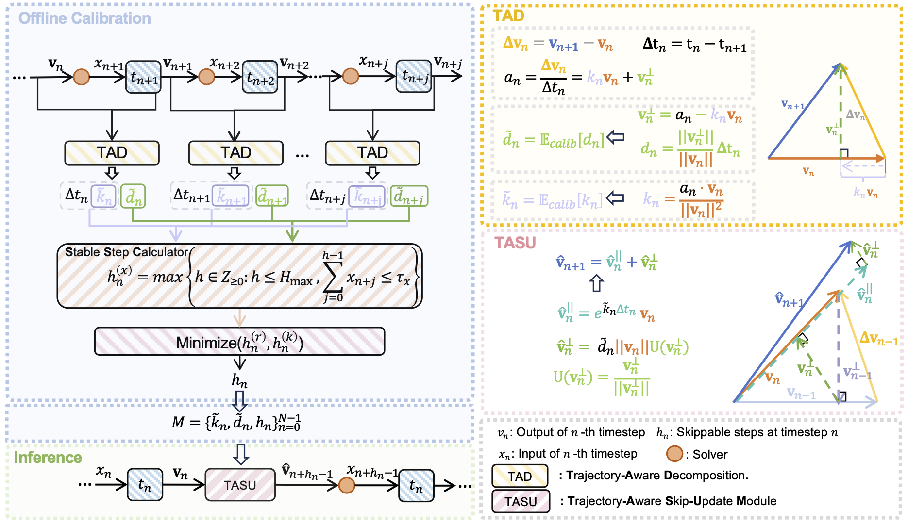
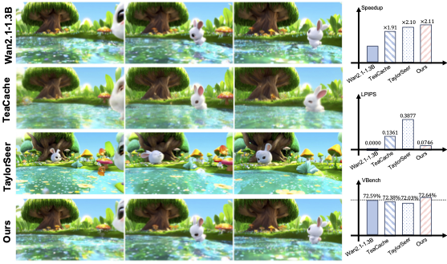
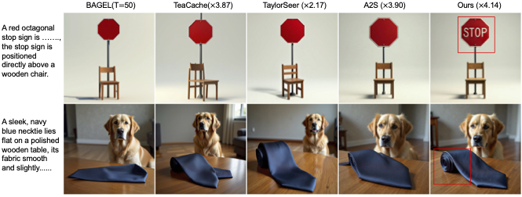
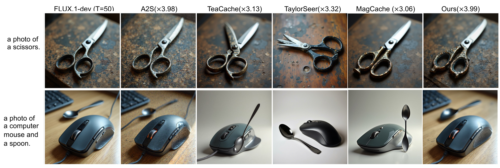
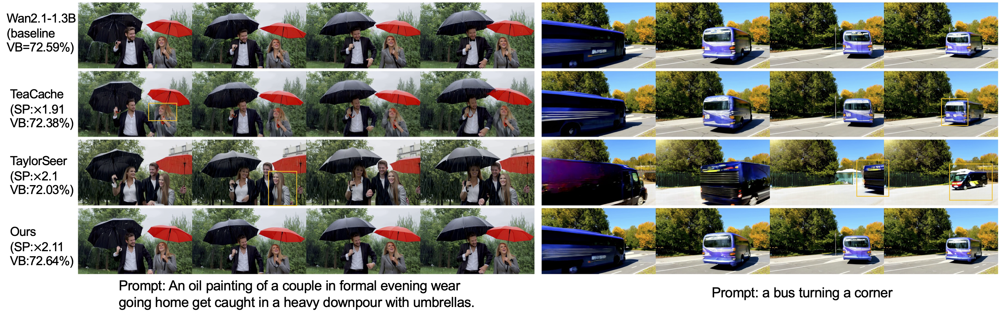

<h1 align="center">Accelerating Rectified Flow Models  via Trajectory-Aware Caching</h1>

<p align="center">
  <a href="https://github.com/XiaoLiu1237">XiaoLiu</a>,
  <a href="https://kai-liu.cn/">KaiLiu</a>,
  <a href="https://scholar.google.com/citations?user=TVyk3f0AAAAJ&hl=en">Naiyang Guan</a>,
  <a href="https://lukebird17.github.io/">Honglang Lu</a>,
  <a href="https://scholar.google.com/citations?user=tZS6bPMAAAAJ&hl=en&oi=sra">Zhixin Wang</a>,
  <a>Zhikai Chen</a>,
  <a href="https://scholar.google.com/citations?hl=en&user=zEEMPUUAAAAJ&view_op=list_works&sortby=pubdate">Renjing Pei</a>，
  <a href="https://scholar.google.com/citations?hl=en&user=-wm2X-8AAAAJ&view_op=list_works&sortby=pubdate">Linghe Kong</a>，
  <a href="https://yulunzhang.com/">Yulun Zhang</a>
</p>

<p align="center">
  <i>ArXiv 2026</i>
</p>

<p align="center">
  
  
  
</p>

<p align="center">
  <a href="YOUR_ARXIV_URL">[arXiv]</a>
  <a href="YOUR_SUPP_URL">[supplementary material]</a>
</p>

---

## 🔥 News
- **2025-2-6:** Repo released.

---

## Abstract
## Abstract
> **Abstract:** 
> Diffusion models have emerged as a dominant paradigm in contemporary generative modeling.
However, their deployment in the real world is severely constrained by the substantial latency inherent because of the multi-step iterative inference.
One emerging solution is to reduce the temporal redundancy via time step skipping.
Existing caching methods typically rely on selecting a subset of timesteps and reusing their computational outputs to approximate intermediate steps. 
However, the accumulation errors in the skipped steps limit the speedup ratio.
To address this challenge, we propose TACache, a novel acceleration-based caching framework.
TACache follows the skip-then-compensation paradigm.
To be specific, TACache follows an offline skipping schedule to perform step skipping.
For the skipped steps, TACache leverages statistical acceleration information to compensate for the parallel and orthogonal directions.
Extensive experiments on Text-to-Image (T2I) and Text-to-Video (T2V) models demonstrate that TACache achieves superior Pareto optimality in the trade-off between quality and speed compared to state-of-the-art methods.


---

## ✨ Pipeline
<p align="center">
  
</p>


---

## 🚀 TODO
- [ ] Release the calibration dataset.
- [ ] Release code.

---

## 🔗 Contents
1. [code](#code)
2. [Results](#results)
3. [Citation](#citation)
4. [Acknowledgements](#acknowledgements)

---

## 📦 Results
<p align="center">
  
</p>
<p align="center">
  
</p>
<p align="center">
  
</p>
<p align="center">
  
</p>

## 📎 Citation

If you find this code helpful in your research or work, please consider citing:

```bibtex
@article{your2026project,
  title   = {A Trajectory-Decomposition Acceleration Method for Diffusion Inference},
  author  = {Liu, Xiao and Liu, Kai, and Guan, Naiyang and Lu, Honglang and Wang, Zhixin and Chen, Zhikai and Pei, Renjing and Kong, Linghe and Zhang, Yulun},
  journal = {arXiv},
  year    = {2026},
  note    = {arXiv:XXXX.XXXXX}
}
